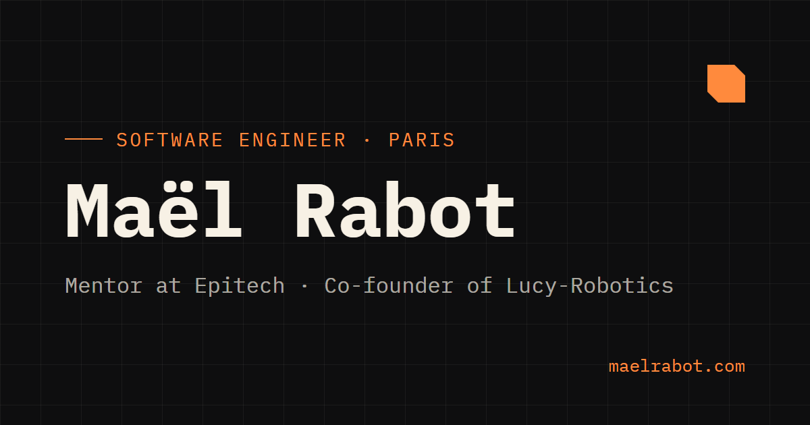

<a href="README.md">English</a> · <b>Français</b>

  
  
  
  

Je suis ingénieur logiciel à Paris. J'accompagne les étudiants d'**[Epitech](https://international.epitech.eu/)** dans leurs projets et je développe **[Lucy](https://lucy-robotics.com/)**, un framework open source qui simplifie l'utilisation des robots.

Je termine un Master en informatique à Epitech, après une année d'échange à l'université Chung-Ang de Séoul. J'aime la programmation bas niveau, la conception orientée objet, le développement web et la robotique, et je cherche toujours le prochain sujet à apprendre.

## Ce que je fais aujourd'hui

<table>
  <tr>
    <td width="50%" valign="top">
      <h3>Accompagner</h3>
      <b>Mentor pédagogique</b> · Epitech International, Paris 
      2026 – Aujourd'hui
      
J'accompagne des étudiants internationaux en échange et des étudiants en MSc 1 &amp; 2 tout au long de leurs projets : revues de code, soutenances et suivi individuel. Mon objectif : les rendre autonomes face aux problèmes qu'ils rencontrent.

      
<b>150+</b> étudiants en échange · <b>25</b> nationalités 
      C · C++ · Python · TypeScript/Vue.js · Elixir · DevOps

    </td>
    <td width="50%" valign="top">
      <h3>Construire</h3>
      <b>Co-fondateur &amp; product manager</b> · <a href="https://lucy-robotics.com/">Lucy-Robotics</a> 
      2024 – Aujourd'hui
      
Avec Lucy-Robotics, nous développons Lucy : un framework open source qui simplifie l'utilisation des robots, quel que soit le robot. Je travaille sur l'architecture ROS 2, j'encadre les équipes techniques et je pilote la feuille de route produit.

      
<b>2</b> robots supportés · <b>100 %</b> open source 
      ROS 2 · C++ · Rust · Python · TypeScript

    </td>
  </tr>
</table>

## Projet phare : Lucy

> **Une plateforme // N'importe quel robot**

Lucy est un framework robotique open source. Son cœur exécute toute la logique ROS 2 et s'installe en quelques commandes sur macOS, Windows ou Linux, sans Docker. Les robots se branchent d'un côté, les interfaces de contrôle de l'autre.

| Interfaces | | Cœur Lucy | | Robots |
| :--- | :---: | :--- | :---: | :--- |
| Lucy Control Panel · CLI · HuRI (IA) · la vôtre | → | ROS 2 · `ros2_control` · `lucy_ws` · firmware embarqué | → | InMoov · bras SO-101 · le vôtre |

[Site web](https://lucy-robotics.com/) · [Documentation](https://docs.lucy-robotics.com/share/p1x9ikjkhf/p/public-documentation-EExgMX2REV) · [GitHub](https://github.com/Lucy-Robotics) · [Feuille de route](https://projects.sentience-robotics.fr/) · [Discord](https://discord.gg/g4KNZ3eeBd)

## Projets choisis

<table>
  <tr>
    <td width="50%" valign="top">
      <a href="https://github.com/Lucy-Robotics/HuRI"><b>HuRI</b></a> · Framework d'IA · en cours 
      Interaction humain-robot : conversation vocale, mémoire multi-niveaux et ancrage cinématique pour que les robots dialoguent et bougent naturellement. 
      <code>Python</code> <code>ROS 2</code>
    </td>
    <td width="50%" valign="top">
      <a href="https://github.com/Mael-RABOT/NotARhythmGame"><b>Not A Rhythm Game</b></a> · Jeu PC 
      Jeu de rythme open source inspiré de Muse Dash, avec un éditeur de niveaux complet et un moteur audio maison. 
      <code>C++</code> <code>ImGui</code> <code>GLFW</code> <code>BASS</code>
    </td>
  </tr>
  <tr>
    <td valign="top">
      <a href="https://mael-rabot.itch.io/ast3roid"><b>Ast3roid</b></a> · Jeu PC 
      Jeu de vaisseau inspiré d'Asteroids, réalisé pour le cours de game design de l'université Chung-Ang. Jouable sur itch.io. 
      <code>Rust</code> <code>Bevy</code> <code>Blender</code>
    </td>
    <td valign="top">
      <a href="https://github.com/ASM-Studios/R-Type"><b>R-Type</b></a> · Moteur de jeu 
      Moteur de jeu ECS multiplateforme recréant le classique d'arcade, avec multijoueur en réseau. 
      <code>C++</code> <code>CMake</code> <code>ECS</code>
    </td>
  </tr>
  <tr>
    <td valign="top">
      <a href="https://github.com/ASM-Studios/AREA"><b>AREA</b></a> · Application web 
      Reproduction de la plateforme d'automatisation action-réaction IFTTT, avec OAuth2 et double authentification. 
      <code>TypeScript</code> <code>Go</code> <code>Docker</code>
    </td>
    <td valign="top">
      <a href="https://github.com/ASM-Studios/ASM-corewar"><b>Corewar</b></a> · Programmation système 
      Arène de machine virtuelle et assembleur de bytecode où des programmes s'affrontent pour survivre en mémoire. 
      <code>C</code> <code>Assembleur</code>
    </td>
  </tr>
  <tr>
    <td valign="top">
      <a href="https://github.com/Mael-RABOT/Pandoc"><b>Pandoc Parser</b></a> · Outil système 
      Parseur et convertisseur de formats de documents basé sur des transformations d'AST. 
      <code>Haskell</code>
    </td>
    <td valign="top">
      <a href="https://github.com/Mael-RABOT/microsoftTeams"><b>Teams TUI Clone</b></a> · Application terminal 
      Clone léger de Microsoft Teams en terminal, avec messagerie multi-clients via sockets réseau. 
      <code>C</code> <code>Sockets BSD</code>
    </td>
  </tr>
</table>

Plus de projets sur [maelrabot.com/projects](https://maelrabot.com/projects).

## Compétences

  

**Aussi :** ros2_control, Bevy, Vue.js, Elixir, PHP, SQL, Bash, URDF, impression 3D 
**Langues :** français (natif), anglais (C1)

## Expériences

- **Mentor pédagogique** — Epitech International · *2026 – Aujourd'hui* 
  Revues de code, soutenances et suivi individuel de 150+ étudiants internationaux et en MSc.
- **Co-fondateur &amp; product manager** — Lucy-Robotics · *2024 – Aujourd'hui* 
  Architecture du framework ROS 2, encadrement d'équipe, planification des sprints et feuille de route produit.
- **Développeur full stack** — AudioWizard · *Juil. 2023 – Août 2025* 
  SaaS pour audioprothésistes : TypeScript, Node.js, React, PostgreSQL, intégration continue et maintenance en production.
- **Développeur R&amp;D** — PoC Innovation Lab · *Janv. 2023 – Août 2023* 
  Modèles de deep learning transformant des images en partitions musicales (PyTorch, CNN, IA générative).
- **Animateur d'ateliers &amp; mentor** — Coding Club · *Févr. 2023 – Févr. 2025* 
  Ateliers de programmation et hackathons pour faire découvrir le développement logiciel aux lycéens.

**Formation :** Master en informatique, Epitech Lyon (2022 – 2027) · Programme international d'ingénierie, université Chung-Ang, Séoul (2025 – 2026)

## Organisations

&nbsp;

**[Lucy-Robotics](https://github.com/Lucy-Robotics)** — framework robotique open source · **[ASM-Studios](https://github.com/ASM-Studios)** — projets de groupe à Epitech

---

  <b>Construisons quelque chose ensemble.</b> 
  Ouvert aux postes en ingénierie logicielle, aux collaborations autour du mentorat et de la pédagogie, et aux projets de robotique.  
  <a href="mailto:contact@maelrabot.com">contact@maelrabot.com</a> · <a href="resume_fr.pdf">CV (FR)</a> · <a href="resume_en.pdf">Resume (EN)</a>

